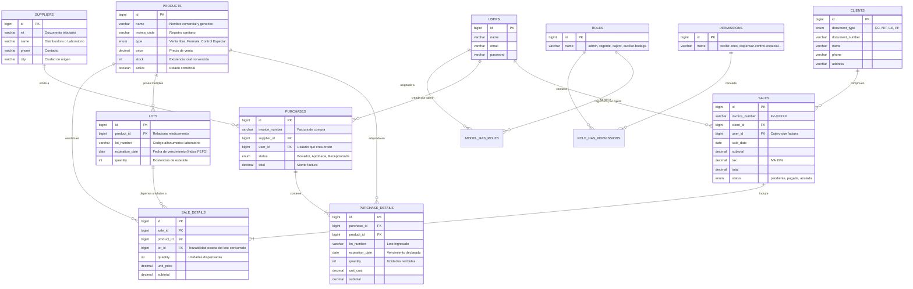

# Diagrama Entidad - Relación (MER)
**Droguería Vida Sana — Cartago (Valle del Cauca)**  
*Segundo Parcial · Cotecnova 2026*  
**Estudiantes:** Miguel Ángel Ramírez Gutiérrez ([@MiguelAngelRamirezGutierrez](https://github.com/MiguelAngelRamirezGutierrez)) & Andrés Felipe Mejía Suaza ([@NiquelAwol](https://github.com/NiquelAwol))  

---

### Explicación de Cardinalidades y Flujo de Datos

1. **`PRODUCTS (1) ───< LOTS (N)`**:  
   Un mismo medicamento puede tener múltiples lotes en bodega con diferentes fechas de caducidad. Cada lote pertenece estrictamente a un único producto.
2. **`LOTS (1) ───< SALE_DETAILS (N)`**:  
   Un lote puede abastecer varias líneas de venta en diferentes transacciones. Cada línea de venta de un producto identifica de qué lote provienen sus unidades para garantizar la trazabilidad sanitaria (**FEFO**).
3. **`SALES (1) ───< SALE_DETAILS (N) >─── (N:1) PRODUCTS`**:  
   Una venta contiene uno o más productos vendidos, registrando cantidad, precio y lote.
4. **`SUPPLIERS (1) ───< PURCHASES (N) ───< PURCHASE_DETAILS (N)`**:  
   Un proveedor puede surtir múltiples compras; cada compra contiene detalles donde se declaran los lotes y vencimientos que luego se dan de alta en `lots`.
5. **`USERS (N) ─── (N) ROLES (N) ─── (N) PERMISSIONS`**:  
   Modelo RBAC (Role-Based Access Control) mediante Spatie para gobernar la segregación de funciones entre Administrador, Regente, Cajero y Auxiliar de Bodega.
